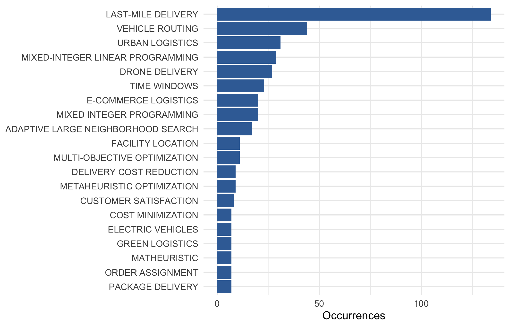
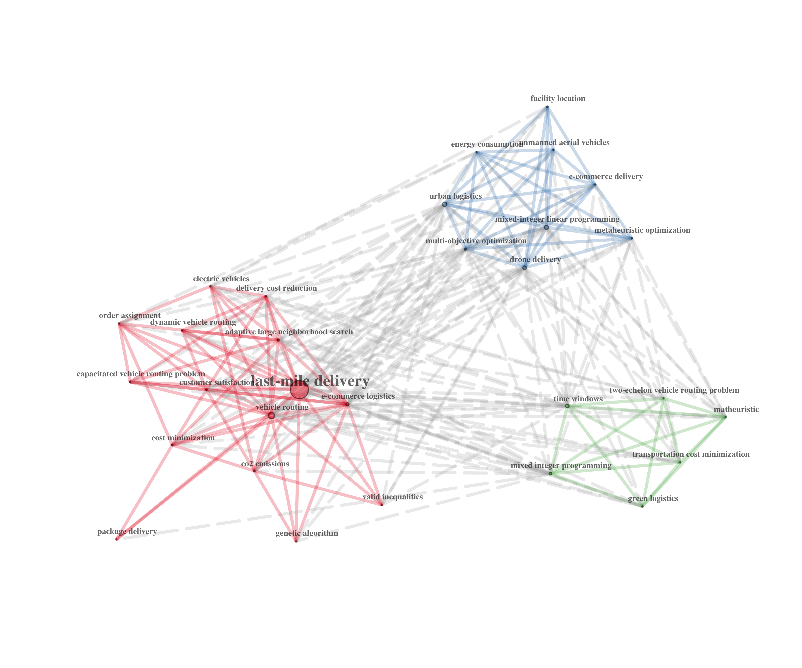
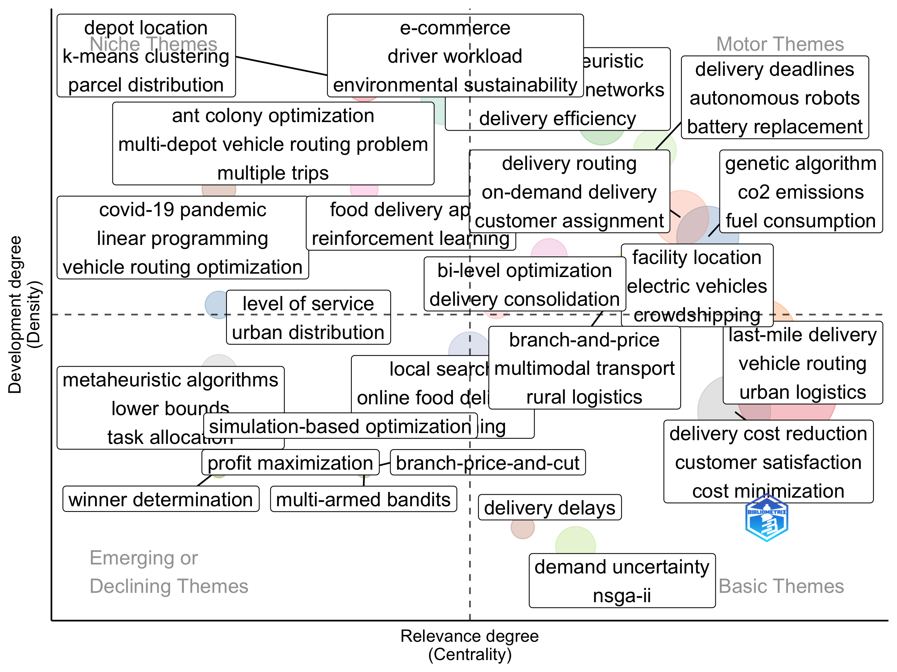
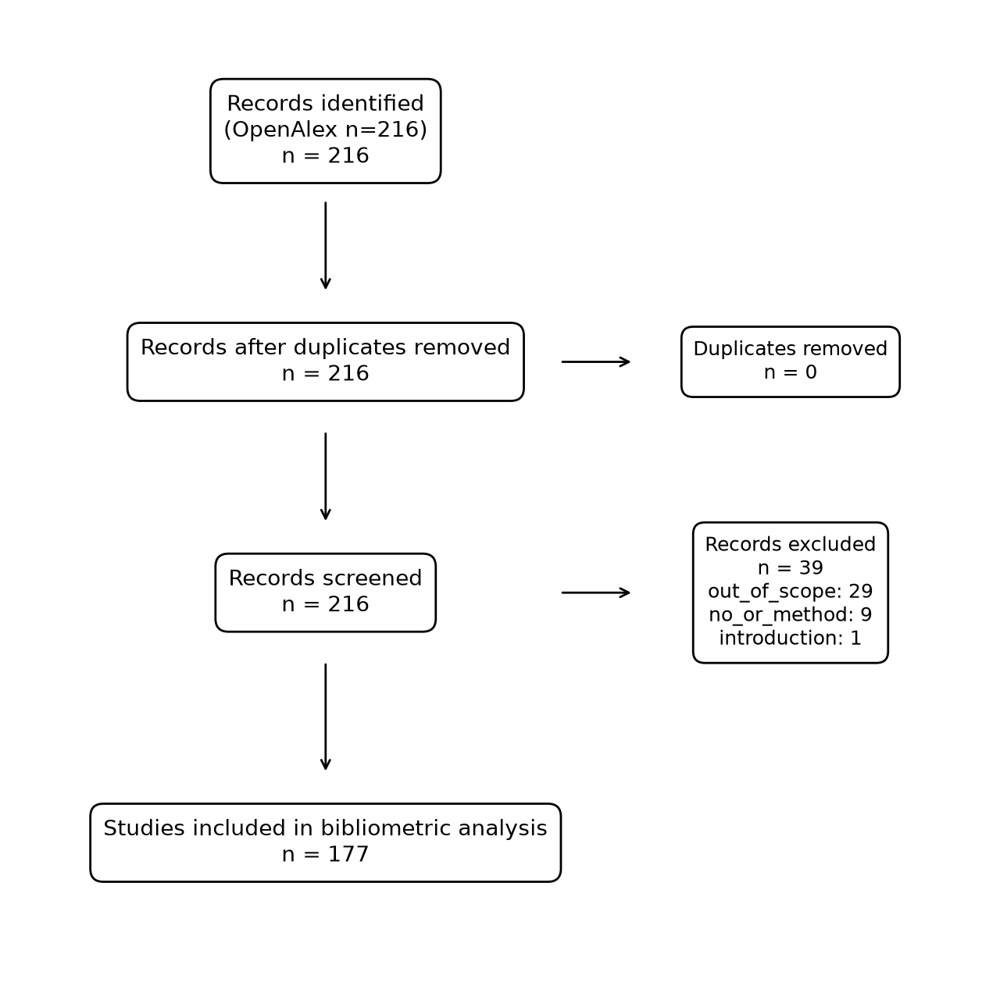

<!--
Budget: 12 pages max (guidelines). Rough word budget for ~6,000 words total is
given per section. Replace the instructor's template formatting once received
(drop it in as paper/template.docx; `make paper` picks it up).
Cite with [@citationKey]; keys come from the Mendeley export (references.bib).
Paper rubric (10 marks): novelty & intro 2, lit review & methodology 2,
structure & clarity 2, discussion & future agenda 2, publication 2.
-->

# Introduction

<!-- ~600 words. Rubric: novelty of topic + introduction. -->

TODO(human): context and why the problem matters (industry / managerial relevance).

TODO(human): what is novel about this study relative to existing work.

The study addresses the following research questions:

- **RQ1.** TODO(human) (copy from config/project.yaml)
- **RQ2.** TODO(human)

TODO(human): contributions (2-3 bullets) and outline of the paper.

# Literature review

<!-- ~1,400 words. Rubric: literature review. Draw on biblio/figures and core_papers_matrix.csv. -->

## Bibliometric overview

TODO(human): publication trend (Figure @fig:annual), leading journals, authors, countries.

{#fig:annual width=80%}

{#fig:keywords width=80%}

{#fig:cooc width=90%}

{#fig:thematic width=90%}

TODO(human): interpret each figure in prose; a figure without interpretation earns nothing.

## Thematic synthesis of core studies

TODO(human): group the 10-20 core papers by theme/method (from core_papers_matrix.csv).
Table: problem type x method x data x key finding.

## Research gaps

TODO(human): gaps that motivate RQ2 and the future research agenda.

# Research methodology

<!-- ~700 words. Rubric: research methodology. -->

## Bibliometric data collection

TODO(human): from biblio/search_protocol.md: database, exact search string, filters
(academic journals, English, YEAR-YEAR), date executed, records identified.
Screening and exclusions summarised in Figure @fig:prisma.

{#fig:prisma width=75%}

TODO(human): tools: Mendeley (reference management, metadata verification),
Bibliometrix/Biblioshiny (analysis), Google Scholar citation counts (retrieved DATE).

## Optimisation approach

TODO(human): why this OR method answers RQ2 (justify from the literature).

# Problem description and model formulation

<!-- ~900 words. Project rubric: 20/100 for the model. -->

TODO(human): system description (nodes, vehicles, tasks, activities) and assumptions.

**Sets and indices.** TODO(human)

**Parameters.** TODO(human)

**Decision variables.** TODO(human)

**Objective.**

$$
\min \sum_{i}\sum_{j} c_{ij} x_{ij} \qquad \text{TODO(human): replace with final objective}
$$

**Constraints.** TODO(human): number each constraint and explain it in one sentence.

# Data

<!-- ~400 words. From data/README.md. -->

TODO(human): sources, preprocessing, summary statistics table.

# Solution approach

<!-- ~300 words. -->

TODO(human): solver (HiGHS via PuLP), hardware, time limits, instance sizes
(toy -> full), baseline used for comparison (e.g. Vogel / nearest neighbour).

# Results and sensitivity analysis

<!-- ~1,000 words. Project rubric: 20/100. Use results/*.json and results/sensitivity_*. -->

TODO(human): main results table (objective, baseline, % improvement, solve time).

{#fig:sens width=95%}

TODO(human): interpret: which parameters matter, thresholds, robustness.

# Discussion

<!-- ~600 words. Rubric: discussions and future research agenda. -->

## Managerial implications

TODO(human)

## Limitations

TODO(human)

## Future research agenda

TODO(human): tie each item back to a gap from the literature review.

# Conclusion

<!-- ~250 words. -->

TODO(human): answer each RQ in one or two sentences; key recommendation.

# References

::: {#refs}
:::
